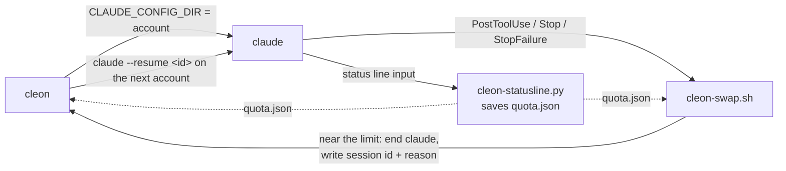

<p align="center">
  <h1 align="center">👑 cleon</h1>
  <p align="center"><strong>Run Claude Code on all your Claude accounts. When one runs out, the next one carries on the same chat.</strong></p>
  <p align="center">
    <a href="https://github.com/serhii-kucherenko/cleon/actions/workflows/test.yml"></a>
    <a href="LICENSE"></a>
    
    
    <a href="https://code.claude.com"></a>
  </p>
</p>

---

<p align="center">
  
</p>

## 😤 The problem

You are deep in a Claude Code session. Then the account hits its limit:

- The agent stops in the middle of a step.
- You log out, log in to your other account, and find the chat again.
- Your settings, hooks and skills are set up for one account only.
- You explain the task again, and the new chat makes the same mistakes again.

**You have the quota. You just cannot use it without breaking your flow.**

## ✨ The solution

`cleon` runs Claude Code on a list of accounts. Before an account runs out, it asks the agent to
stop at a safe point and write a handoff. Then it opens the **same chat** on the next account,
and the agent carries on from the handoff.

```text
 account "work"                               account "personal"
┌──────────────────────────────┐             ┌──────────────────────────────┐
│ you: finish the refactor     │             │ cleon: resume the paused work│
│ agent: runs the tests ...    │             │ agent: picking up from the   │
│ week at 95% ─▶ pause note    │──same chat─▶│        handoff ...           │
│ agent: writes the handoff    │             │ you keep working             │
└──────────────────────────────┘             └──────────────────────────────┘
```

The name comes from the Cleon emperors in *Foundation*. They are a line of clones. When one is
spent, the next one takes the throne, and the empire carries on.

## 🎯 What you get

- **🔄 One chat, many accounts.** The chat moves to the next account with its full history.
- **🛑 A safe stop.** At 95% of the 5-hour or the weekly quota (you can change both), the agent finishes its step and writes a handoff. It does not break off in the middle of a change.
- **⚡ A hard limit is not the end.** On a usage limit or a dead login, `cleon` moves the chat at once and says "Continue where you stopped".
- **🧭 Top first.** `cleon` starts on the first account in your order that has quota left. Each switch also looks from the top, so the first accounts are used up first.
- **📊 One view of all quota.** `cleon ls` shows each account's 5-hour and weekly use, with reset times.
- **⏳ Waits for you.** When every account is out, `cleon` waits for the first reset and carries on there.
- **🧩 One setup.** All accounts share your settings, hooks, skills, plugins and chat history. Each keeps its own login.
- **🖥️ Every system.** macOS, Linux, WSL and Windows (Git Bash). `cleon` finds the system by itself.
- **🔒 Local only.** Plain bash and a small Python status line. No server, no API keys, nothing leaves your machine.

## 🏗️ Claude Code alone vs Claude Code + cleon

| Situation | Claude Code alone | Claude Code + cleon |
|---|---|---|
| **The weekly quota runs low** | 🔴 You find out when it is gone, often in the middle of a change. | 🟢 At 95% (by default), the agent gets a note to reach a safe point and write a handoff. |
| **The quota runs out** | 🔴 The turn stops. You `/logout`, `/login`, and find the chat again. | 🟢 `cleon` resumes the same chat on the next account, by itself. |
| **Settings and skills** | 🔴 A second config folder means a second copy of everything. | 🟢 Every account links to one `~/.claude`. Change it once. |
| **Resume an old chat** | 🔴 A chat lives under the account that started it. | 🟢 Any account can `--resume` any chat. |
| **Which account to use** | 🟡 You guess, or check each one on claude.ai. | 🟢 `cleon` picks the first account with room. `cleon ls` shows all of them. |
| **Every account is out** | 🔴 You come back later and check by hand. | 🟢 `cleon` waits in the terminal until the first reset, then carries on. |

## 🚀 Quick start

```bash
git clone https://github.com/serhii-kucherenko/cleon.git ~/cleon
~/cleon/install.sh
cleon add personal          # log in to your second account
```

Then use `cleon` where you used `claude`. All `claude` flags work.

## 📖 Set up, step by step

**1. Get the code.** Keep the clone: the install links to it, so `git pull` updates `cleon`.

```bash
git clone https://github.com/serhii-kucherenko/cleon.git ~/cleon
```

**2. Install.**

```bash
~/cleon/install.sh
```

```text
cleon is installed: /Users/you/.local/bin/cleon -> /Users/you/cleon/bin/cleon
Old settings saved to /Users/you/.claude/settings.json.bak
Next: cleon ls
```

If you had a status line, it still shows, and the installer says so. If `~/.local/bin` is not on
your `PATH`, the installer gives you the line to add.

**3. Name your current account (optional).** Your normal `~/.claude` login is the first account,
called `main`. Give it a clearer name:

```bash
cleon name work
```

**4. Add your other accounts.** Each one opens the Claude login page. Log in with that account.

```bash
cleon add personal
cleon add spare
```

`cleon` refuses an account whose login is already in the list. Names use lowercase letters, digits
and `-`.

**5. Set the order.** The order is the priority. `cleon` uses the first account with quota left, and goes back to it when its quota resets.

```bash
cleon order work personal spare
```

**6. Check.**

```bash
cleon ls
```

The quota bars show after the first chat on each account. To see them at once, run one short chat
on each: `cleon @personal "say hi"`.

**7. Use it.**

```bash
cleon                                   # a new chat on the first account with room
cleon "fix the failing test"            # a new chat with a prompt
cleon --resume                          # pick an old chat to resume
cleon @personal                         # use this account, whatever its quota
cleon --dangerously-skip-permissions    # flags pass through, and stay after a switch
```

## 📸 What it looks like

### `cleon ls`

```text
 cleon accounts   order = priority · cleon starts on the first with room · auto-resume on · reserve 5h 5% week 5%

 ● work        work@example.com   ← cleon starts here
     ✓ logged in   max plan · worked 3m ago
     5h    ████████░░░░░░░░░░░░  41%   resets in 2h 9m
     week  ██████████░░░░░░░░░░  50%   resets in 3d 3h

 ○ personal    personal@example.com
     ✓ logged in   pro plan · worked 2h 5m ago
     5h    ██░░░░░░░░░░░░░░░░░░  12%   resets in 2h 9m
     week  ████░░░░░░░░░░░░░░░░  20%   resets in 3d 3h
```

The bar turns yellow 25 points before the limit and red at it.

### A switch

```text
$ cleon "finish the billing refactor"
  ...the agent runs the tests on "work", which reaches 96% of its week...
  ● All 128 tests pass. This account is at its weekly reserve, so here is the handoff.
    Done: the billing refactor, invoice.py split in three.
    Next: update docs/billing.md to the new names.

cleon: work paused its work at its 5% weekly reserve. Continuing on personal.

  ...the same chat opens on "personal"...
  > Resume the paused work: the last account reached its quota reserve. Carry on from your handoff.
  ● Picking up from the handoff. The refactor is done, so I update docs/billing.md next.
```

## 🔧 How it works



| Part | What it does |
|---|---|
| `bin/cleon` | Picks an account, starts `claude` on it, and resumes the chat on the next account when told. |
| `hooks/cleon-statusline.py` | Saves each account's quota to `<config dir>/quota.json`. Claude Code sends the quota only to the status line, so this is where `cleon` catches it. |
| `hooks/cleon-swap.sh` | At the reserve, asks the agent to pause. At the end of that turn, or on a hard limit, it ends `claude` and tells `cleon` why. In a session that `cleon` did not start, it does nothing. |

Your normal `~/.claude` login is the first account. Each other account is a folder
`~/.cleon/<name>`, used as `CLAUDE_CONFIG_DIR`. It has its own login and its own
`.claude.json`. The shared parts are symlinks to `~/.claude`. To keep the accounts in another
folder, make `~/.cleon` a link to it: `ln -s ~/my-accounts ~/.cleon`. `cleon` follows the link to
the real folder, and a link works in every shell. `CLEON_HOME=~/my-accounts` works too, but only in
shells started after you set it. When `cleon` finds only one account, it says so.

## 🛠️ Commands

| Command | What it does |
|---|---|
| `cleon [@name] [claude args]` | Start `claude` on the first account with room, or on `name`. |
| `cleon add <name>` | Add an account and log in to it. Run it again to log in again. |
| `cleon ls` | List the accounts, their logins, and their 5-hour and weekly quota. |
| `cleon order <name...>` | Set the order `cleon` uses the accounts in. |
| `cleon name <name>` | Name the `~/.claude` account (default `main`). |
| `cleon resume [on\|off]` | After a switch, the next account carries on by itself (`on`, the default), or opens the chat and waits for you (`off`). |
| `cleon reserve [5h\|week] [percent]` | Show or set the quota each account keeps back, of its 5-hour and its weekly quota (default 5% of each). Without `5h` or `week`, it sets both. |
| `cleon help` | Show the commands. |

## ⏱️ What happens at a limit

| Event | What `cleon` does | You see |
|---|---|---|
| 5-hour or weekly use reaches its reserve during a turn | The agent gets a note to finish its step and write a handoff. At the end of the turn, the next account resumes the chat with "Resume the paused work". | `cleon: work paused its work at its 5% weekly reserve. Continuing on personal.` |
| 5-hour or weekly use reaches its reserve at the end of a turn | The next account opens the chat and waits for your next prompt. | `cleon: work is down to its 5% weekly reserve. Continuing on personal.` |
| A hard usage limit (5-hour or weekly) | The next account resumes the chat with "Continue where you stopped". | `cleon: work hit its limit. Continuing on personal.` |
| The login stopped working | The same as a limit. | `cleon: personal has a login that no longer works (cleon add personal). ...` |
| Every account is out | `cleon` waits in the terminal until the first reset. Ctrl+C stops the wait. | `cleon: every account is out of room. Waiting until 14:05 (in 1h 12m).` |

### Change the reserve

Each account keeps 5% of its 5-hour quota and 5% of its weekly quota. The weekly reserve keeps
the account usable for small jobs. Both give the agent time to stop at a safe point.

```bash
cleon reserve 15        # both
cleon reserve 5h 10     # only the 5-hour reserve
cleon reserve week 20   # only the weekly reserve
```

```text
5-hour reserve: 10% (cleon skips an account at 90% 5-hour use)
weekly reserve: 20% (cleon skips an account at 80% weekly use)
```

The values are saved in `~/.cleon/.reserve-5h` and `~/.cleon/.reserve`. A `cleon` that runs now
keeps its old values. The next `cleon` you start uses the new ones. A reserve of 0 turns it off, so
`cleon` switches only at a hard limit. To stop the next account from carrying on by itself after a
switch, run `cleon resume off`.

## 🤔 Why not just...

| Alternative | Limitation |
|---|---|
| **`claude setup-token`** | The token is for inference only. claude.ai connectors and Claude in Chrome do not load with it. |
| **Pay for the API instead** | You pay for each token, on top of the plans you already have. |

## 📦 What `install.sh` does

```text
✓ Links bin/cleon to ~/.local/bin/cleon
✓ Registers hooks/cleon-swap.sh for PostToolUse, Stop and StopFailure in ~/.claude/settings.json
✓ Sets hooks/cleon-statusline.py as the status line
✓ Keeps your old status line: its command moves to ~/.cleon/.statusline, and cleon's status line runs it
✓ Saves your old settings to ~/.claude/settings.json.bak
```

It is safe to run again, for example after you move the clone.

## 🧩 Share more files between accounts

`cleon` shares a fixed, safe list: settings, `CLAUDE.md`, hooks, commands, agents, skills,
plugins, output styles, mods, chat history, todos, plans and tasks. It never shares a login, a
quota or a cache. To share more, put the names in `~/.cleon/.shared`, one per line:

```bash
echo "my-notes.md" >> ~/.cleon/.shared
```

`cleon` links them the next time it starts each account.

## 🪐 Use with [Superset](https://superset.sh)

Set the Claude agent command to `cleon` (Settings, Agents, Claude, Agent command). Then every
Claude tab, resume and fork goes through `cleon`. Leave the account in Superset's Usage tab unset.
Superset sets `CLAUDE_CONFIG_DIR` from it, and that replaces the account `cleon` picks.

## 📋 Requirements

- [Claude Code](https://code.claude.com), logged in once in the normal way. Tested on 2.1.301.
- `bash`, `jq` and Python 3.
- Two or more Claude accounts on a Pro or Max plan. Claude Code reports quota only for these plans.

| System | Install the tools | Notes |
|---|---|---|
| **macOS** | `brew install jq` | Python 3 comes with the Xcode tools. |
| **Linux** | `sudo apt install jq python3` | |
| **WSL** | `sudo apt install jq python3` | Install Claude Code inside WSL too. Then it is the same as Linux. |
| **Windows** | [Git for Windows](https://git-scm.com/download/win), then `winget install jqlang.jq` and `winget install Python.Python.3.12` | Run `cleon` in Git Bash. Turn on Developer Mode (Settings, System, For developers), so `cleon` can make real links. |

`cleon` finds the system by itself, with `uname -s`.

## 🩺 Troubleshooting

| Problem | Fix |
|---|---|
| `cleon: command not found` | Add `~/.local/bin` to your `PATH`, then open a new terminal. |
| `cleon ls` says "no quota seen yet" | Run one chat on that account: `cleon @<name> "say hi"`. |
| `cleon ls` says "not logged in" | It shows the command to log in again: `cleon add <name>`, or `claude auth login` for the `~/.claude` account. |
| `cleon` does not switch at a limit | Check that the hook is registered: `grep cleon-swap ~/.claude/settings.json`. If not, run `install.sh` again. |
| A resumed chat lost a flag | `cleon` keeps `--dangerously-skip-permissions`, `--model`, `--permission-mode`, `--agent`, `--add-dir`, `--settings` and any `--flag=value`. Add others to the `keep` list in `bin/cleon`. |

## 🧑‍💻 Development

```bash
python3 tests/test_cleon.py     # end-to-end tests (macOS and Linux)
bash tests/smoke.sh             # the parts that differ per system (also Windows)
vhs demo/cleon.tape             # makes demo/cleon.gif again
```

The tests run the real `claude` through `cleon` in a terminal, in a throwaway `HOME`, against a
fake API on your machine. They cover a hard limit, the reserve, the pause and the handoff, the
wait when every account is out, `cleon reserve`, and `install.sh`. They need `claude`, `jq`, and
one real login in `~/.claude.json` (only its settings are copied).

`tests/smoke.sh` checks the parts that differ per system: ending `claude`, sharing files (on
Windows also with junctions and hard links), and reading the quota. CI runs it on Ubuntu, macOS
and Windows at each push. To check your own machine, run it (in Git Bash on Windows). It needs
`node`, and it does not need a login.

The demo also runs the real `cleon` and `claude`, against `demo/fake_api.py`. It uses a throwaway
`HOME` with two example accounts, so no real login or chat shows. It needs
[vhs](https://github.com/charmbracelet/vhs).

## 🗑️ Uninstall

```bash
~/cleon/install.sh --uninstall
```

This removes the link, the hook and the status line, and puts back your old status line. Your
accounts stay in `~/.cleon`. Delete that folder to remove them too.

## ⚠️ Known limits

`cleon` moves the chat, its files and your setup. It cannot move what belongs to the Claude
account itself. Read this before you rely on a switch in the middle of important work.

### Logins and tools

| Limit | Why | What to do |
|---|---|---|
| **MCP logins are per account.** An MCP server that needs a login (OAuth) asks again on each account. | The token is saved with the account's login: in the macOS Keychain, one entry per account folder, or in that folder's `.credentials.json` on Linux and Windows. | Log in once on each account: `cleon @personal`, then `/mcp`. |
| **claude.ai connectors are per account.** Slack, Google Drive and other connectors come from the claude.ai account. | Each account has its own connector list on claude.ai. | Add the same connectors on each account. If not, a resumed chat can lose a tool it used before the switch. |
| **New MCP servers do not spread.** A server you add later with `claude mcp add` (user scope) shows only on the account you added it on. | Each account gets a copy of `~/.claude.json` at its first use. After that, the copies are separate. | Add it on each account: `cleon @personal mcp add ...`. A project's `.mcp.json` works on all accounts, because it lives in the repo. |
| **Org rules differ.** A work account can have managed settings, other models or other limits. | Each account keeps its own `remote-settings.json` and `policy-limits.json`. | Expect the rules to change after a switch. A `--model` that `cleon` keeps can fail on a plan that does not have that model. |

### Things that live on claude.ai

| Limit | Why | What to do |
|---|---|---|
| **Artifacts, Claude Docs, claude.ai projects and cloud sessions belong to one account.** After a switch, the agent cannot update an artifact that the first account published. | They are owned by the account that made them. | Share the artifact with edit access to your other accounts, or finish that part on one account (`cleon @work`). |
| **Background jobs are per account.** A job started on one account does not show on another. | Each account keeps its own `jobs`, `sessions` and `daemon` folders. Chat history is shared, so `--resume` lists every chat. | Check jobs on the account that started them. |

### Quota and cost

| Limit | Why | What to do |
|---|---|---|
| **The quota figure is the last one seen on this machine.** Use on claude.ai, the desktop app or another computer does not count until the next `cleon` chat on that account. | Claude Code sends the quota only to the status line of a running chat. | `cleon` can start on an account that is already out. Then the first request fails, and `cleon` moves on by itself. |
| **A switch loses the prompt cache.** The first reply on the next account reads the whole chat again, without the cache. | The prompt cache belongs to the account's organization. Accounts in different organizations do not share it. | In a long chat, the first reply after a switch is slower and uses more quota. |
| **Each tool call runs the hook.** | The hook checks the quota after each tool call. | It adds about 50 ms per tool call (measured on an Apple Silicon Mac). |

### How a switch happens

| Limit | Why | What to do |
|---|---|---|
| **A hard limit can break a turn in the middle of a step.** | The usage limit stops the request at once. The 95% reserve exists to avoid this. | After "Continue where you stopped", check for half-done edits. Keep a reserve: `cleon reserve 5` or more. |
| **A switch ends `claude`.** Shell commands it runs in the background, and its helper agents, can stop with it. | `cleon` must end `claude` to start it again on the next account. | Ask the agent in its handoff to start again what was running. |
| **Only the terminal.** The desktop app, the VS Code and JetBrains extensions, and claude.ai/code do not use `cleon`. | Only a `claude` that `cleon` starts can switch. | Use `cleon` in a terminal, or set it as the agent command in [Superset](https://superset.sh). |
| **`claude -p` (print mode) only switches at a hard limit, and the resumed chat opens in interactive mode.** | Print mode has no status line, so `cleon` never sees the quota. `cleon` does not keep `-p` after a switch. | Use `cleon` for interactive chats. |
| **A 2-second pause at each switch.** | It gives you time to read the switch message before the next `claude` redraws the screen. | Nothing to do. |

### Setup

| Limit | Why | What to do |
|---|---|---|
| **Moving the accounts folder on macOS logs you out.** | The Keychain entry is tied to the folder path. | After you change `CLEON_HOME`, run `cleon add <name>` again for each account. |
| **Windows without Developer Mode uses hard links for files.** `cleon` says `... is a hard link`. A hard link stops being shared when a program saves the file anew. | Windows allows symlinks only with Developer Mode or admin rights, so `cleon` falls back to junctions for folders and hard links for files. | Turn on Developer Mode, delete that file in the account folder, and start `cleon` again. It makes a real link. |
| **Use only accounts you may use.** | Each account is a separate Claude plan, under Anthropic's terms. | Do not share one account between people. |

## 📄 License

[MIT](LICENSE)

---

<p align="center">
  <strong>Built for people who have more quota than patience.</strong><br>
  <a href="https://github.com/serhii-kucherenko/cleon/issues">Issues</a> · <a href="#-quick-start">Quick start</a> · <a href="#-how-it-works">How it works</a>
</p>
