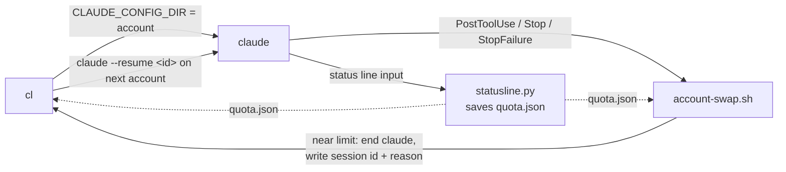

# claude-accounts

`cl` runs Claude Code on more than one Claude account. When one account runs out of quota, `cl`
moves the same chat to the next account, and the chat carries on.

```text
$ cl "refactor the billing module"
...work on account "main"...
cl: main paused its work at its 5% weekly reserve. Continuing on personal.
...the same chat goes on, on account "personal"...
```

- Each account has its own login. All accounts share your settings, hooks, skills and chat history.
- `cl` starts on the first account in your order that has quota left.
- Near the weekly limit, `cl` asks the agent to stop at a safe point and write a handoff. Then it
  resumes the chat on the next account.
- On a hard usage limit or a dead login, `cl` moves the chat at once.
- When every account is out, `cl` waits for the first reset, then carries on there.

## How it works



| Part | What it does |
|---|---|
| `bin/cl` | Picks an account, starts `claude` on it, and restarts the chat on the next account when told. |
| `hooks/statusline.py` | Saves each account's quota to `<config dir>/quota.json`. Claude Code sends quota only to the status line. |
| `hooks/account-swap.sh` | At 95% weekly use, asks the agent to pause. Then ends `claude` and tells `cl` why. Does nothing in a session that `cl` did not start. |
| `install.sh` | Links `cl` and registers the hook and status line in `~/.claude/settings.json`. |

Each extra account is a folder `~/.claude-accounts/<name>`, used as `CLAUDE_CONFIG_DIR`. It has its
own login and its own `.claude.json`. The shared parts (settings, hooks, skills, plugins, chat
history) are symlinks to `~/.claude`. So any account can resume any chat. Your normal
`~/.claude` login is the first account, named `main`.

## Requirements

- macOS or Linux, with `bash`.
- [Claude Code](https://code.claude.com), logged in once in the normal way. Tested on 2.1.301.
- `jq` (`brew install jq` or `apt install jq`) and `python3`.
- Two or more Claude accounts on a Pro or Max plan. Claude Code reports quota only for these plans.

## Set up, step by step

**1. Get the code.**

```bash
git clone git@github.com:serhii-kucherenko/claude-accounts.git ~/claude-accounts
```

Keep the clone. The install links to it, so `git pull` updates `cl`.

**2. Install.**

```bash
~/claude-accounts/install.sh
```

```text
cl is installed: /Users/you/.local/bin/cl -> /Users/you/claude-accounts/bin/cl
Old settings saved to /Users/you/.claude/settings.json.bak
Next: cl ls
```

If you had a status line, it still shows. The installer says so. If `~/.local/bin` is not on your
`PATH`, the installer gives you the line to add.

**3. Name your current account (optional).** Your normal `~/.claude` login is called `main`. Give it
a clearer name:

```bash
cl name work
```

**4. Add your other accounts.** Each one opens the Claude login page. Log in with that account.

```bash
cl add personal
cl add spare
```

`cl` refuses an account whose login is already in the list. Names use lowercase letters, digits
and `-`.

**5. Set the order.** `cl` uses the first account with quota left.

```bash
cl order work personal spare
```

**6. Check.**

```bash
cl ls
```

```text
 Claude accounts   order = priority · cl starts on the first with room · auto-resume on · reserve 5%

 ● work        you@company.com   ← cl starts here
     ✓ logged in   max plan · worked 3m ago
     5h    ████████░░░░░░░░░░░░  41%   resets in 2h 10m
     week  █████████████░░░░░░░  63%   resets in 3d 4h

 ○ personal    you@gmail.com
     ✓ logged in   pro plan · not used yet
     no quota seen yet: it shows after the first chat on this account
```

The quota bars show after the first chat on each account. Run one short chat on each:
`cl @personal "say hi"`.

**7. Use `cl` where you used `claude`.** All `claude` flags work.

```bash
cl                                   # new chat on the first account with room
cl "fix the failing test"            # new chat with a prompt
cl --resume                          # pick an old chat to resume
cl @personal                         # use this account, whatever its quota
cl --dangerously-skip-permissions    # flags pass through, and stay after a switch
```

## Commands

| Command | What it does |
|---|---|
| `cl [@name] [claude args]` | Start `claude` on the first account with room, or on `name`. |
| `cl add <name>` | Add an account and log in to it. |
| `cl ls` | List accounts, logins, and 5-hour and weekly quota. |
| `cl order <name...>` | Set the order `cl` uses the accounts in. |
| `cl name <name>` | Name the `~/.claude` account (default `main`). |
| `cl resume [on\|off]` | After a switch, the next account carries on by itself (`on`, the default), or opens the chat and waits for you (`off`). |
| `cl reserve [percent]` | Show or set the weekly quota each account keeps back (default 5). |
| `cl help` | Show the commands. |

## What happens at a limit

| Event | What `cl` does | Message |
|---|---|---|
| Weekly use reaches 95% during a turn | The agent gets a note to finish its step and write a handoff. At the end of the turn, `cl` resumes on the next account and says "Resume the paused work". | `cl: work paused its work at its 5% weekly reserve. Continuing on personal.` |
| Weekly use reaches 95% at the end of a turn | Resumes on the next account and waits for your next prompt. | `cl: work is down to its 5% weekly reserve. Continuing on personal.` |
| Hard usage limit (5-hour or weekly) | Resumes on the next account and says "Continue where you stopped". | `cl: work hit its limit. Continuing on personal.` |
| The login stopped working | Same as a limit. Log in again with `cl add <name>`. | `cl: work has a login that no longer works (cl add work).` |
| Every account is out | Waits in the same terminal until the first reset. Ctrl+C stops the wait. | `cl: every account is out of room. Waiting until 14:05 (in 1h 12m).` |

The 5% weekly reserve keeps each account usable for small jobs. To change it for all accounts:

```bash
cl reserve 15
```

```text
weekly reserve: 15% (cl skips an account at 85% weekly use)
```

The value is saved in `~/.claude-accounts/.reserve`. A `cl` that runs now keeps its old value. The
next `cl` you start uses the new one. `cl reserve 0` turns the reserve off: `cl` then switches only
at a hard limit.

## Share more files between accounts

`cl` shares only a fixed, safe list: settings, `CLAUDE.md`, hooks, commands, agents, skills,
plugins, output styles, mods, chat history, todos, plans and tasks. It never shares a login, a quota
or a cache. To share more, put the names in `~/.claude-accounts/.shared`, one per line:

```bash
echo "my-notes.md" >> ~/.claude-accounts/.shared
```

`cl` links them the next time it starts each account.

## Use with [Superset](https://superset.sh)

Set the Claude agent command to `cl` (Settings, Agents, Claude, Agent command). Then every Claude
tab, resume and fork goes through `cl`. Leave the account in Superset's Usage tab unset: Superset
sets `CLAUDE_CONFIG_DIR` from it, and that replaces the account `cl` picks.

## Troubleshooting

| Problem | Fix |
|---|---|
| `cl: command not found` | Add `~/.local/bin` to your `PATH`, then open a new terminal. |
| `cl ls` says "no quota seen yet" | Run one chat on that account: `cl @<name> "say hi"`. |
| `cl ls` says "not logged in" | It shows the command to log in again: `cl add <name>`, or `claude auth login` for the `~/.claude` account. |
| `cl` does not switch at a limit | Check that the hook is in `~/.claude/settings.json`: `grep account-swap ~/.claude/settings.json`. If not, run `install.sh` again. |
| A resumed chat lost a flag | `cl` keeps `--dangerously-skip-permissions`, `--model`, `--permission-mode`, `--agent`, `--add-dir`, `--settings` and any `--flag=value`. Add others to the `keep` list in `bin/cl`. |

## Uninstall

```bash
~/claude-accounts/install.sh --uninstall
```

This removes the link, the hooks and the status line, and puts back your old status line. Your
accounts stay in `~/.claude-accounts`. Delete that folder to remove them too.

## Test

```bash
python3 tests/test_account_swap.py
```

The test runs the real `claude` through `cl` in a terminal, in a throwaway `HOME`, against a fake
API on your machine. It covers a hard limit, the weekly reserve, the pause and handoff, the wait
when every account is out, and `install.sh`. It needs `claude`, `jq`, and one real login in
`~/.claude.json` (it copies only the settings in it).

## License

MIT
